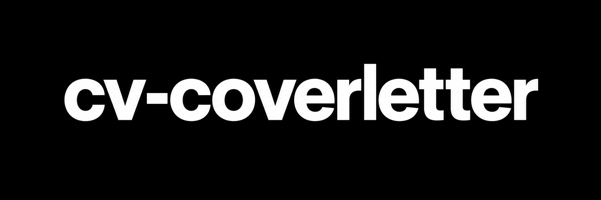

# cv-ats-us — company-first job applications for Claude Code



Turns a candidate's real evidence and verifiable research on a company (startup, SME, mid-size,
multinational, public or non-profit) into an ATS-readable CV, a cover letter written for **that** company,
and interview talking points. Strategy comes before writing; every
company fact is sourced and dated or labelled as a hypothesis; every candidate claim traces to a document.

## Requirements
- Claude Code with project skills and subagents (tested with 2.1.294). `AGENTS.md` is read natively.
- Python 3.9+ (stdlib only, no install). macOS adds independent text-extraction checks (textutil, PDFKit).
  Windows: `python3` is often absent or a Microsoft Store alias; run the same commands with `python` or `py -3`.
- WebSearch/WebFetch for company research. No MCP server or external dependency required.

## Usage
```
/cv-ats-us Tailor my CV to this posting https://… and write a cover letter explaining why my projects are relevant to this company. CV: inputs/cv.pdf, projects: inputs/projects.md
```
| Mode | Output | Checked by `audit_package.py` |
|---|---|---|
| `create` | CV without a target | evidence, CV |
| `tailor` | CV for a posting or company | + company, job, strategy, employment contract |
| `cover-letter` | letter only | + letter, contribution |
| `package` | CV + letter + dossier + interview points | everything |
| `projects` | advice on which projects to show, no package | not run |
| `audit` | review of existing documents, no package | not run; `check_docs.py` extraction only |

Market and language are separate settings. The market sets paper and conventions: `US` (US Letter, no photo),
`FR` (A4, degree / availability / alternance when known), `INTERNATIONAL` (paper of the job's country, A4 if
unknown). The language follows the posting unless you ask for another one. Both are inferred when not given.

Put private inputs in `inputs/`; outputs land in `applications/<company>-<role>-<date>/` — both git-ignored:
`package.json` (sources, claims, evidence with verbatim excerpts, contract fit, strategy, texts),
`*_Resume|CV_*.docx/.pdf`, `*_Cover-Letter|Lettre-de-motivation_*.docx/.pdf`, `build.json` (what was built from
which package content), `targets.json` and `audit.json` (statements checked by the auditor and its verdicts),
`dossier.md` (brief, evidence table, contract fit, strategy, questions, interview prep).

## How it works
| Step | Component | Tools |
|---|---|---|
| Company intelligence | `.claude/agents/company-researcher.md` | WebSearch, WebFetch, Read (read-only) |
| Why the role exists | `.claude/agents/job-intelligence.md` | WebFetch, WebSearch, Read (read-only) |
| Candidate evidence | `.claude/agents/candidate-evidence.md` | Read, WebFetch (read-only) |
| Positioning + adaptation per lever | `.claude/agents/recruitment-strategist.md` | Read (read-only) |
| Writing + files | `.claude/skills/cv-ats-us/SKILL.md` + `scripts/` | main session |
| Independent audit | `.claude/agents/application-auditor.md` | Read, WebFetch (read-only) |

Model policy: a large model orchestrates, subagents run small — Claude Code agents use `model: haiku`
(Haiku 5.5) whatever the main model (Fable, Opus, Sonnet). Deterministic guardrails in `scripts/`:
- `audit_package.py`: truth rules for every package (sources, numbers and years in the cited evidence, evidence
  excerpts found verbatim in the candidate's files, gaps never in the CV even when partly matched, sourced named
  recipients, hedged hypotheses, an open posting needs a reachable source, no ATS score, differentiation with
  `--compare`); contract rules for `meta.schema: 2` (mode, employment-contract fit, hiring context,
  contribution sized to the contract, level assessment, questions), warnings for older packages.
  `--targets FILE` lists the statements `application-auditor` must judge; `--verdicts audit.json` checks that
  every target got a `supported` verdict quoting meaningful source text verbatim. Targets include headers, CV section
  titles, interview questions, available company claims and dossier assessments (gaps, differentiation); conflicting
  current verdicts are refused in any order; so are empty CV sections and invalid generation settings.
- `build_docs.py`: DOCX + PDF and `build.json`; refuses a PDF whose text the standard PDF font cannot show.
- `check_docs.py`: layout (including hidden properties in applicable styles), two-way text extraction, and
  documents matching `build.json` for the current package. It expands file patterns on Windows too.
All three scripts accept JSON UTF-8 with or without a BOM. Schema versions are integers; malformed types
produce located diagnostics rather than falling back to the older contract.
References and university sources: `.claude/skills/cv-ats-us/references/`.

## Codex
- Skill: `.agents/skills/cv-ats-us` is a symlink to the Claude skill (one source). Invoke with `$cv-ats-us`.
- Agents: `.codex/agents/*.toml`, generated from `.claude/agents/*.md` with `model = "gpt-6-luna"` and
  `sandbox_mode = "read-only"`. After editing an agent: `python3 tools/sync_codex_agents.py`.
  `--check` also reports orphan TOML files after a source agent is retired; it never removes them.
- Codex only loads `.codex/` for **trusted** projects: accept the trust prompt when opening this folder in
  Codex, or add `[projects."<this folder>"] trust_level = "trusted"` to `~/.codex/config.toml`.
  Untrusted, the skill still loads but the five agents do not.
- Web search inside Codex subagents depends on your `web_search` setting (not documented for subagents).
- Windows: `SKILL.md` and `.agents/skills/cv-ats-us` are symlinks. With `core.symlinks=false` (the default
  without Developer Mode) git writes them as small text files and Codex cannot load the skill; `run_tests.py`
  then skips the two link tests with this explanation. To get real links: enable Developer Mode, then
  ```bash
  git config core.symlinks true
  ```
  ```bash
  git checkout -- SKILL.md .agents/skills/cv-ats-us
  ```
  Or use WSL. Claude Code itself does not use these two links.

## claude.ai, ChatGPT and Gemini
```bash
python3 tools/build_portable.py
```
Builds `dist/cv-ats-us/`, `dist/cv-ats-us.zip` and `dist/gemini/SKILL.md` (git-ignored) from the same sources and
checks them (200-character description, one `SKILL.md`, text files only, no Claude Code-only text). Upload the zip in
claude.ai (Customize → Skills; code execution on) or ChatGPT (Skills → Add), and the single file in Gemini (Skills →
import): references and roles appended, no scripts, the model runs the checks itself and delivers text. The agents
become roles run in turn by one model, so the audit is not independent. Rebuild and re-upload after each change.

## Global install (optional links, single source)
`SKILL.md` at the root links to `.claude/skills/cv-ats-us/SKILL.md` (edit either, same file; its relative
links resolve from the skill folder). To use the skill in every folder, create links to this project:
`~/.claude/skills/cv-ats-us`, `~/.claude/agents/<agent>.md`, `~/.agents/skills/cv-ats-us` (Codex),
`~/.codex/agents/<agent>.toml` (Codex). The repository does not create them; moving or deleting this folder
breaks them. A copy uploaded elsewhere (for example to a claude.ai account) is not updated by this repository.

## Tests
```bash
python3 tests/run_tests.py
```
Offline, fictitious fixtures: config/frontmatter, privacy, DOCX/PDF build and extraction, and guardrail
mutations for scenarios (a) two companies, (b) poorly documented company, (c) missing technology,
(d) project without metrics, (e) unreachable site, (f) document extraction, (g) the same title at a startup,
an SME, a mid-size company, a multinational and a company of unknown size. Regression tests cover each defect
found in review (partly matched gaps, unchecked CV dates and degrees, evidence numbers absent from the
candidate's files, open postings without a reachable source, interview points, named recipients, PDF character
loss, stale documents, e2e runs reusing earlier outputs), the employment contract, levels, questions,
differentiation, auditor verdicts, and an older package (`tests/fixtures/packages/legacy/`) that must still pass.
`tests/test_review_regressions.py` (run by `run_tests.py`) adds 24 offline regression cases: header/dossier coverage,
partial PDFs, conflicting verdicts, Windows input formats, agent retirement, empty CV sections, interview questions,
gaps and differentiation, letter dates, generation settings and e2e audit rounds.

```bash
python3 tests/e2e/run_e2e.py --model haiku
```
Live: runs `/cv-ats-us` headless on the same fixtures and checks the outputs. Uses API credits
(`--budget` per scenario); never applies or sends anything.

## Company context
The researcher classifies the company only from its own sourced size/stage/structure facts (customer size is
not company size; a group is not the hiring unit) and finds why it is hiring now. The strategist then records
one adaptation per lever (positioning, experience, projects, keywords, letter, register), each traced to a
claim or requirement id. Size steers research, never content: see
`.claude/skills/cv-ats-us/references/company-context.md`.

## Limits
- No ATS score, no guarantee of passing a screen or getting an interview: parsers differ.
- Research is light and targeted: public pages only; no login, CAPTCHA, paywall or anti-bot bypass;
  LinkedIn often requires login and is then skipped. Thin results lead to cautious personalisation.
- The PDF uses Helvetica (Arial metrics, standard PDF font). For an exact Arial/Calibri PDF, export the DOCX
  from Word or LibreOffice. Text outside that font (e.g. ł, ő, ș) gets no PDF: export the DOCX. DOCX page count is
  approximated by the PDF.
- The scripts prove references, numbers, years, verbatim quotations and structure, not meaning: a shifted month,
  "expected" turned into "awarded", a number moved between facts or a stronger level word are judged by
  `application-auditor`, a small model whose verdicts can be wrong.
- A CV given only as a PDF whose text the standard library cannot extract (hex-encoded or `TJ` text) is not
  verified: the audit reports `"verification": {"complete": false}` until a DOCX or text export is recorded as
  `copy_path`. On macOS, PDFKit is tried first.
- `run_e2e.py` recognises the strategist's final note by its `## strategy` header, in its tool result or in a
  later notice; the exact transcript format of background-agent notices was not checked on a live run.
- No mode yet compares several postings to choose where to apply.
- No photo support; no automatic applying, emailing or form filling.
